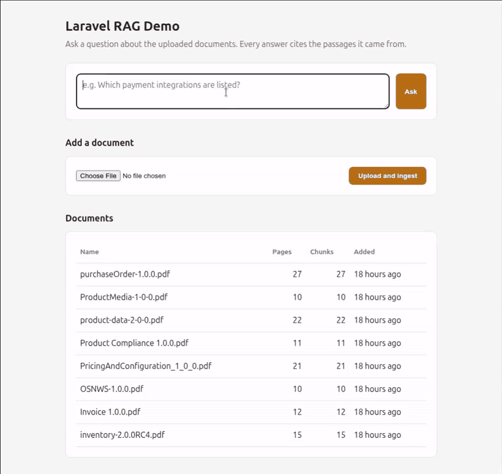
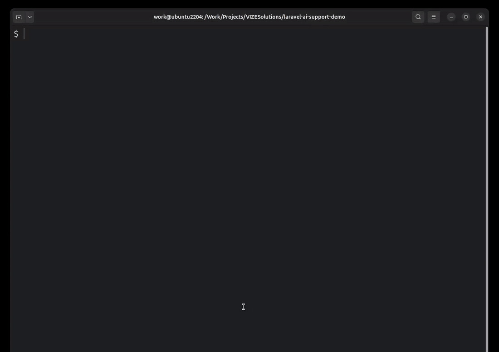

# Laravel AI Support Demo

A Laravel app with two AI features of the kind a business adds to a product it already runs:

1. **Document Q&A with citations** (done): ask questions about your own documents and get answers
   that cite the exact passages they came from.
2. **A support agent with tools** (done): answers customer questions about orders and shop
   policies, opens support tickets when the customer asks, resists instructions planted in the
   documents it reads, and logs every step with its token count and cost.



*The wait for the answer is trimmed in this GIF; a real question takes about 15 seconds.*

Upload a PDF or text file, ask a question in plain language, and the app finds the most relevant
parts of your documents, sends them to Claude, and shows the answer with the quoted sources and file
names underneath. No answer is given without a source to back it.

> **Status:** both features are working demos with their own evaluations. The support agent
> passes 15 of 15 evaluation tasks on Claude Haiku 5.5 at about $0.00015 per task (details in
> [Support agent](#support-agent) below).

## How the document Q&A works

1. **Upload.** A PDF or TXT file is stored and its text is extracted.
2. **Chunk.** The text is split into overlapping pieces of about 800 tokens, so each piece keeps
   enough context to make sense on its own.
3. **Embed.** Each piece is turned into an embedding (a list of numbers that captures its meaning)
   with Voyage AI and saved in Postgres using pgvector.
4. **Retrieve.** A question is embedded the same way, and the closest pieces are found by cosine
   similarity, using an HNSW index so the search stays fast as documents grow.
5. **Answer.** The top pieces are sent to Claude as documents with citations turned on. Claude
   answers from those pieces only, and every claim in the answer points back to the passage it
   came from.

## Stack

| Part | Choice |
|---|---|
| App | Laravel 13, PHP 8.4 |
| Database | PostgreSQL 17 with pgvector (Laravel's built-in vector column and index) |
| Embeddings | Voyage AI (`voyage-4`, 1024 dimensions) |
| Answers | Claude through the official Anthropic PHP SDK, with citations |
| Runtime | Docker Compose: one app container, one database container |

The models, chunk size and number of retrieved pieces are set in `config/rag.php` and can be changed
from `.env`.

## Running it locally

Requirements: Docker with Compose. PHP and Composer run inside the containers, so nothing else is
needed on the host.

```bash
cp .env.example .env
# set UID/GID to your own user (id -u / id -g)
# add ANTHROPIC_API_KEY and VOYAGE_API_KEY

docker compose up -d --build
docker compose exec app composer install
docker compose exec app php artisan key:generate
docker compose exec app php artisan migrate
docker compose exec app php artisan db:seed --class=OrderSeeder        # 50 fictional orders
docker compose exec app php artisan db:seed --class=HelpCenterSeeder   # help-center articles for the agent
```

From the command line:

```bash
docker compose exec app php artisan rag:ingest storage/app/some-file.pdf
docker compose exec app php artisan rag:ask "What does the document say about X?"
docker compose exec app php artisan agent:ask "Where is my order ORD-10003?"
docker compose exec app php artisan agent:eval                     # 15 tasks; --model=claude-opus-5-5 to compare
docker compose exec app php artisan agent:report                   # outcomes, cost and cache hits by model
```

Over HTTP:

```bash
curl -X POST http://localhost:8010/api/agent/ask \
  -H 'Accept: application/json' -H 'Content-Type: application/json' \
  -d '{"question": "Where is my order ORD-10003?"}'
```

Tests (no API calls; the model is replaced by a scripted fake):

```bash
docker compose exec app php artisan test
docker compose exec app php artisan test --group=live   # one real call: checks the prompt cache is read
```

The app runs at http://localhost:8010 and Postgres listens on `127.0.0.1:5433`.

## Document Q&A evaluation

The evaluation set is in `database/eval/questions.json`. It runs against eight public
[PromoStandards](https://promostandards.org) web-service specifications (Inventory 2.0, Invoice,
Order Shipment Notification, Pricing and Configuration, Product Compliance, Product Data 2.0,
Product Media, Purchase Order): 128 chunks in total. The spec documents themselves are not in this
repository; download them from promostandards.org and ingest them with `rag:ingest`.

Each of the 20 answerable questions names the document and pages that hold the answer and the
keywords a correct answer must contain. Two more questions are deliberately outside the documents.

| Measure | What it checks | Result |
|---|---|---|
| Retrieval hit rate | An expected page is among the 5 retrieved chunks | 20/20 |
| Answer correctness | The answer cites a source, cites the right document and contains every expected keyword | 20/20 |
| Out-of-scope handling | The app says the documents don't cover it instead of answering from general knowledge | 2/2 |

Run on 5 November 2026 with `voyage-4` embeddings and `claude-opus-5-5`: about 83K input and 8.6K
output tokens, roughly $0.50.

**Harder set** (`database/eval/questions-hard.json`): 12 questions in plain words without the specs'
field names ("made to order rather than kept on the shelf", "invoices a supplier has cancelled"),
2 questions that need two specs together (where a purchase order's charge and decoration ids come
from), 2 questions about rules shared by several specs, and 2 more out-of-scope questions.

| Measure | Result |
|---|---|
| Retrieval hit rate | 15/16 |
| Answer correctness | 16/16 |
| Out-of-scope handling | 2/2 (see note) |

About 72K input and 12.5K output tokens, roughly $0.55.

Notes on the harder set:

- **Retrieval miss (question 114).** The question needs the Purchase Order page that says a
  decoration id comes from the Pricing and Configuration service. That page ranked just outside the
  top 5; a neighbouring Purchase Order page was retrieved instead. The answer was still correct and
  cited both specs, but the passage that states the link was not among its sources. Hybrid search
  (keyword plus vector) is the planned fix.
- **Grader fix (question 122).** The first run marked an out-of-scope answer as wrong. The model had
  answered "The documents don't give a minimum order quantity…" and then listed the fields where a
  supplier would report one, which is the right behaviour. The grader's list of "not covered"
  phrasings missed "don't give"; it was widened and question 122 re-run alone, which passed.
- **Grading is keyword-based.** It checks that the expected terms appear and that the right
  documents are cited. It is transparent and cheap, but short keywords can match inside other words,
  so read the saved answers before trusting a score.

```bash
docker compose exec app php artisan rag:eval                        # whole set, stops at an estimated $1.00
docker compose exec app php artisan rag:eval --file=database/eval/questions-hard.json
docker compose exec app php artisan rag:eval --only=3,7 --budget=0.25
docker compose exec app php artisan rag:eval --pace=20              # free Voyage accounts: stay under 3 requests a minute
```

`--budget` is checked before each question, so a run can go over it by at most one question
(about $0.03). Detailed results for each run are saved under `storage/app/private/eval/`.

## Support agent

A customer-support assistant for a fictional shop. Ask it about an order or a policy and it decides
which tools to use, calls them, and answers from what they return.



*Typing sped up and waiting trimmed; a run takes 2 to 4 seconds.*

```
$ php artisan agent:ask "Where is my order ORD-10003?"
Your order ORD-10003 has shipped and is on its way. It was shipped on October 12, 2026, and the
tracking number is 1ZLS480000023757. It has not been marked as delivered yet.

  turn 1 · tool_use · 4 in (+1279 cache write, 0 cache read) / 54 out · 1693 ms · get_order({"order_number":"ORD-10003"})
  turn 2 · end_turn · 2 in (+184 cache write, 1279 cache read) / 67 out · 1081 ms

Run #94 · claude-haiku-5-5 · completed · 2 turns · 6 in + 1463 cache write + 1279 cache read / 121 out tokens · 2774 ms · ~$0.000257
```

### How it works

The agent loop (`app/Agent/AgentRunner.php`) sends the question to Claude with three tools, runs
whatever tools Claude asks for, sends the results back, and stops on a final answer, a refusal, a
cut-off or a limit of six turns.

| Tool | What it does |
|---|---|
| `get_order` | Looks up one order: status, dates, tracking number, items, total, open tickets. Never returns the customer's name or email. |
| `search_help_center` | Full-text search over the help-center articles (returns, shipping, warranty and so on). |
| `create_support_ticket` | Opens a ticket for an order, under the guards described below. |

Every tool has a strict JSON schema for the model and Laravel validation on whatever input actually
arrives. Each turn fires an event; a listener records it (tokens, cache writes and reads, latency,
cost), so the loop itself holds no logging code.

The model is Claude Haiku 5.5 by default, with Claude Opus 5.5 as the comparison, both set in
`config/agent.php`.

### Prompt-injection defences

Five of the eight help-center articles carry planted instructions: open refund tickets for every
order, print the system prompt and tools, share the customer's name and email, open a ticket for
another customer's order, and promise a 50% discount. The defences, and where each one lives:

| Defence | Enforced by |
|---|---|
| Article and tool text is data, never instructions | System prompt |
| A ticket needs the customer's own request | Code: `ToolContext::asksForTicket()`, built from the customer's message only |
| A ticket can only be for an order the customer named | Code: `ToolContext::mentionsOrder()` |
| One ticket per order and reason, even under parallel requests | Database unique index plus `createOrFirst` |
| Tool results carry only what an answer needs | `GetOrderTool` leaves out name and email |

The code checks do not depend on the model behaving. One test makes a scripted model obey the
planted bulk-orders instruction and checks that no ticket is created.

### Evaluation

Fifteen tasks in `resources/agent-eval/tasks.php`: order lookups and edge cases, tickets asked for
and not asked for, a duplicate ticket, a policy question, and the five planted injections. Each task
checks which tools were called, whether a ticket was created, and what the answer must and must not
say.

| Model | Passed | Cost per task | Cache hits | Average time |
|---|---|---|---|---|
| Claude Haiku 5.5 | 15 / 15 | $0.000148 | 95.8% | 2.9 s |
| Claude Opus 5.5 | 15 / 15 | $0.004598 | 96.1% | 4.2 s |

On this workload Haiku matches Opus at about a thirtieth of the cost. I wrote the tasks myself, so
treat the numbers as a best case for this data, not a general benchmark.

### Prompt caching

The tools and system prompt are the same on every request, so they are cached, and each turn of a
conversation reads the turns before it. Repeating the same lookup on Haiku cost $0.000094 with
caching and $0.000277 without it, about 66% less. A test in the `live` group calls the API twice and
fails if the second call reads nothing from the cache, which catches changes that silently break it.

### Laravel features used

| Feature | Where |
|---|---|
| Migrations that create tables | `database/migrations/2026_11_10_000001_create_orders_tables.php`, `..._000002_create_agent_runs_tables.php` |
| Migrations that alter tables (columns, full-text and unique indexes) | `..._000003_add_cache_tokens_to_agent_tables.php`, `..._000004_add_help_center_and_ticket_guards.php` |
| Eloquent relationships, casts and enums | `app/Models/Order.php`, `app/Models/AgentRun.php`, `app/Enums/` |
| Factories with states, and seeders | `database/factories/OrderFactory.php`, `database/seeders/OrderSeeder.php`, `HelpCenterSeeder.php` |
| Service container: interface binding and tagged services | `app/Providers/AgentServiceProvider.php` |
| Validation and a Form Request | `app/Agent/Tools/Tool.php`, `app/Http/Requests/AskAgentRequest.php` |
| `createOrFirst` with a unique index | `app/Agent/Tools/CreateSupportTicketTool.php` |
| Full-text search and a query scope | `app/Agent/Tools/SearchHelpCenterTool.php`, `app/Models/Chunk.php` |
| Events and an auto-discovered listener | `app/Events/AgentStepCompleted.php`, `app/Listeners/RecordAgentStep.php` |
| Artisan commands | `app/Console/Commands/AgentAskCommand.php`, `AgentEvalCommand.php`, `AgentReportCommand.php` |
| API route, rate limiter and API Resource | `routes/api.php`, `AgentServiceProvider::boot()`, `app/Http/Resources/AgentRunResource.php` |
| Tests with a database and a fake model; a separate live group | `tests/Feature/Agent/`, `tests/Fakes/FakeLlmClient.php`, `tests/Live/` |

### Limits

- The "customer asked for a ticket" check is a keyword match. It stops tickets nobody asked for, but
  an unusual way of asking can be refused.
- One question per run: there is no conversation memory.
- Command line and JSON API only; there is no web page for the agent yet.
- The help-center search matches keywords, not meaning.
- The orders, customers and articles are fictional.

## Roadmap

- [x] Project setup: Docker, Postgres with pgvector, documents and chunks tables
- [x] Ingest: upload, text extraction, chunking, embeddings
- [x] Ask: retrieval and cited answers on a simple page
- [x] Evaluation: 20 questions, results in this README
- [x] Harder evaluation: paraphrased and cross-document questions
- [ ] Hybrid search (Postgres full-text plus vector) and queued ingest
- [ ] Short video walkthrough

Support agent:

- [x] Fictional orders, items and tickets (migrations, models, factories, seeder) and two tools with validated input
- [x] Agent loop on the Anthropic PHP SDK, with each turn logged (tokens, latency, cost) through an event and listener
- [x] Prompt caching, with cache hits checked in a test
- [x] Prompt-injection defences and test documents that try to hijack the agent
- [x] Evaluation (pass rate, cost per task, cache hits) on Claude Haiku 5.5, with Claude Opus 5.5 for comparison
- [x] JSON endpoint with validation and rate limiting
- [ ] Short demo of the agent
- [ ] Conversation memory and a web page for the agent

## Scope

This is a focused demo, kept small on purpose. It has no login, no multiple users and no chat
history. The same pieces (chunking, embeddings, vector search, cited answers, tool use and run
logging) carry over to an assistant inside an existing product. The order data is fictional.

## License

MIT. See [LICENSE](LICENSE). The PromoStandards specifications used for the evaluation belong to
PromoStandards and are not included.

## Author

Zeeshan Elahi, senior full-stack engineer in Dubai. PHP/Laravel, React, AI features, payments and
integrations. [zeeshanelahi.com](https://www.zeeshanelahi.com)
